# 3-Tier To-Do App on a Custom AWS VPC (Nginx Only)

A working 3-tier application (Web, App, Database) deployed on a custom AWS VPC.
Nginx is the only public entry point. No ALB/NLB, RDS, Elastic Beanstalk, ECS or EKS is used.

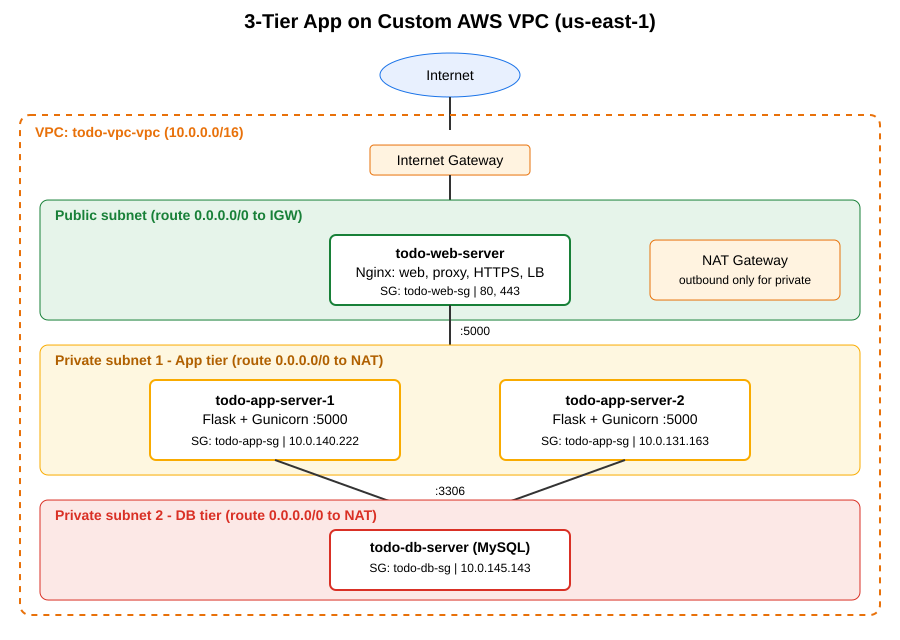

## Architecture

```
Internet -> Internet Gateway -> Nginx (public subnet, 80/443)
                                   |  :5000
                    App-1 / App-2 (private subnet, Flask + Gunicorn)
                                   |  :3306
                         MySQL (private subnet)
```

| Tier | Server | Subnet | Public IP | Software |
|---|---|---|---|---|
| Web | `todo-web-server` | public | Yes | Nginx (static page, reverse proxy, HTTPS, load balancing) |
| App | `todo-app-server-1`, `todo-app-server-2` | private | No | Flask + Gunicorn as a systemd service |
| Database | `todo-db-server` | private | No | MySQL 8 |

## Network (auto-created with "VPC and more" wizard, region us-east-1)

| Resource | Purpose |
|---|---|
| `todo-vpc-vpc` | The private network |
| Public subnet | Web tier; route `0.0.0.0/0 -> Internet Gateway` |
| Private subnet 1 | App tier; route `0.0.0.0/0 -> NAT Gateway` |
| Private subnet 2 | DB tier; route `0.0.0.0/0 -> NAT Gateway` |
| Internet Gateway | Two-way internet access for the public subnet |
| NAT Gateway | Outbound-only internet for private servers (apt, git) |

## Security groups (each tier accepts traffic only from the tier before it)

| SG | Inbound |
|---|---|
| `todo-web-sg` | 80, 443 from `0.0.0.0/0`; 22 from my IP |
| `todo-app-sg` | 5000 from `todo-web-sg`; 22 from `todo-web-sg` |
| `todo-db-sg` | 3306 from `todo-app-sg`; 22 from `todo-web-sg` |

## Deploy

Replace placeholders with your values. Never commit passwords or the `.pem` key.

```bash
# 1. DB server
sudo DB_PASS='<your-password>' bash scripts/setup-db.sh

# 2. Each app server
sudo DB_HOST=<db-private-ip> DB_PASS='<your-password>' bash scripts/setup-app.sh

# 3. Web server (edit nginx/todo.conf with the app private IPs first)
sudo bash scripts/setup-web.sh
```

SSH to private servers goes through the web server:

```bash
ssh-add todo-key.pem
ssh -J ubuntu@<WEB_PUBLIC_IP> ubuntu@<PRIVATE_IP>
```

## Test

- Open `https://<WEB_PUBLIC_IP>` (accept the self-signed certificate warning), add and delete tasks, refresh: data persists.
- Refresh repeatedly: the "Served by app server" line alternates between the two app servers.
- Reboot an app server: `sudo systemctl status todo-app` is `active (running)` automatically.
- Security: from outside, `nc -vz -w5 <WEB_PUBLIC_IP> 5000` and `3306` fail; `443` succeeds.

## Bonus features

- Load balancing between two app servers using an Nginx `upstream`
- HTTPS on Nginx (self-signed certificate, HTTP redirects to HTTPS)
- Setup scripts for all three tiers in `scripts/`

## Screenshots

| | |
|---|---|
| VPC resource map | 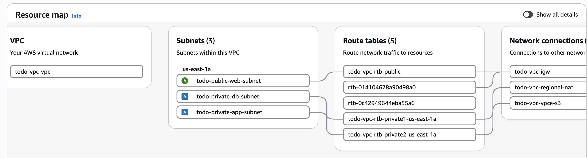 |
| Subnets | 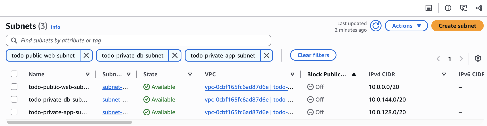 |
| Public route table | 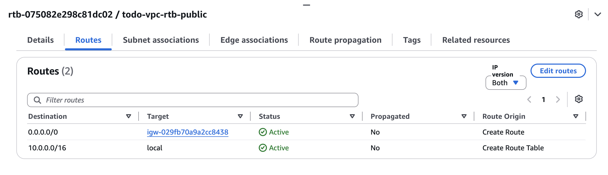 |
| Private route table | 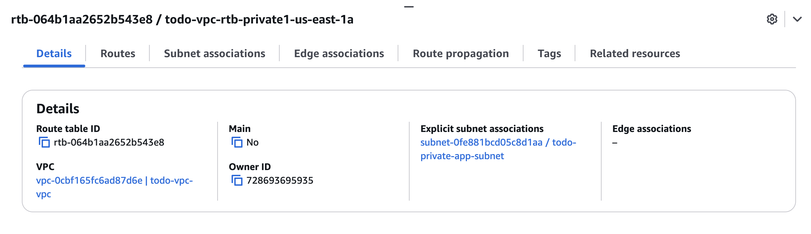 |
| IGW and NAT | 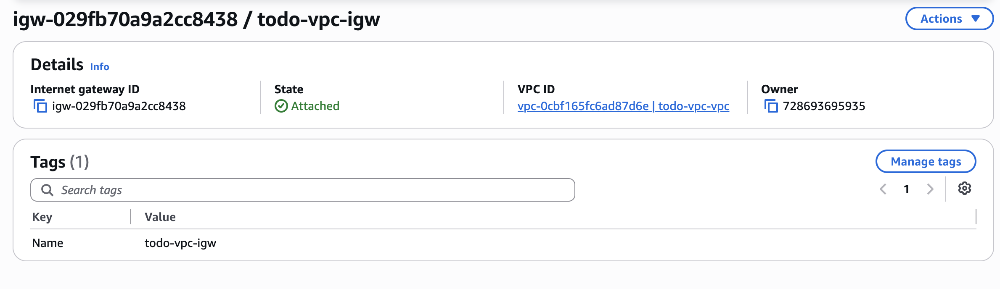 |
| Web SG | 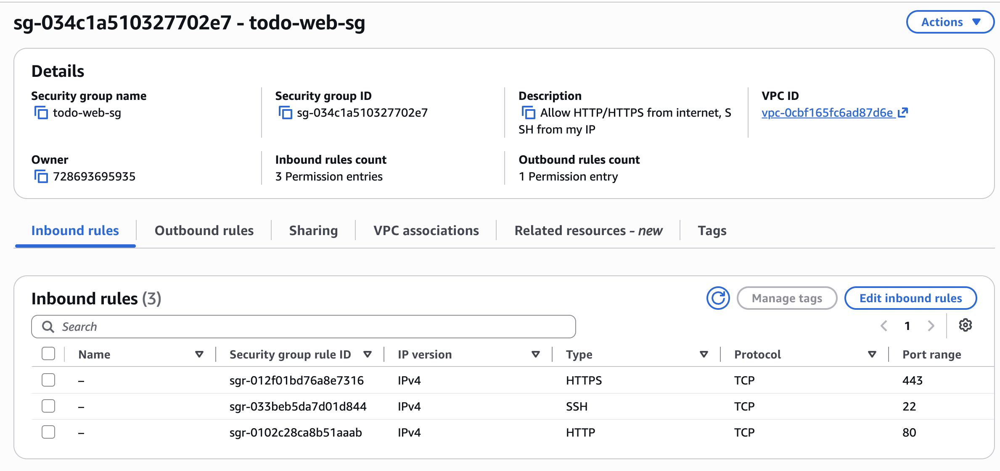 |
| App SG | 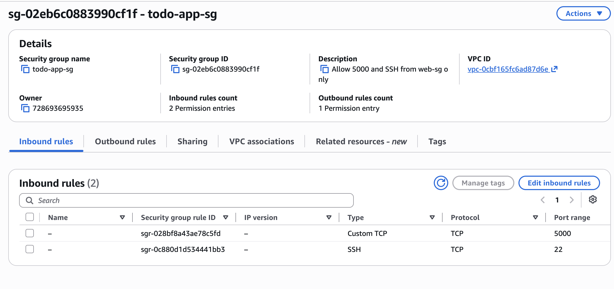 |
| DB SG | 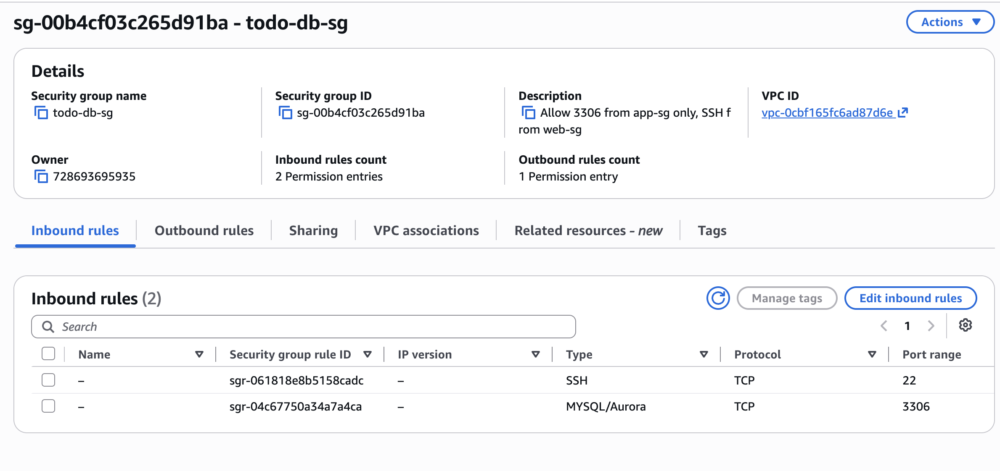 |
| EC2 instances | 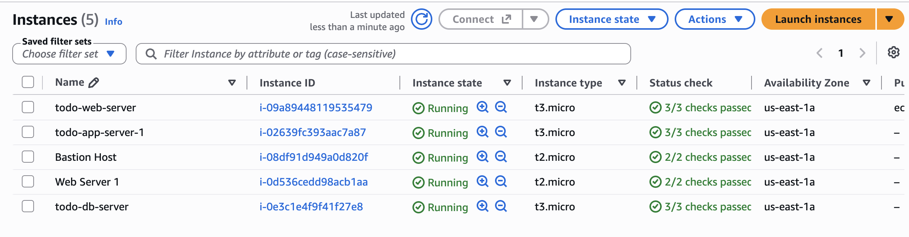 |
| App in browser | 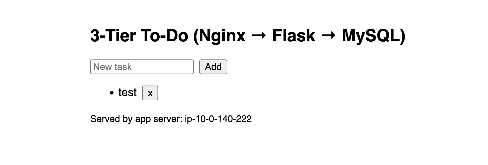 |
| Other app server | 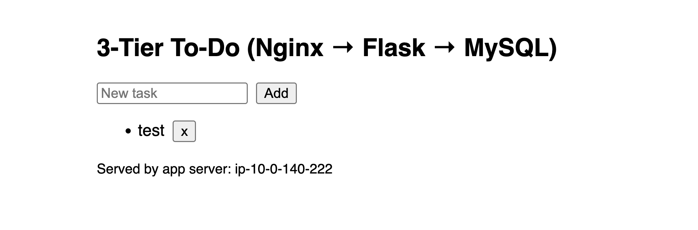 |
| DB rows | 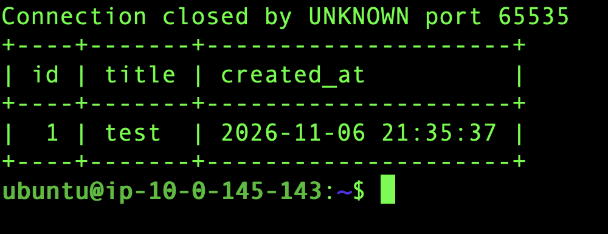 |
| Security test | 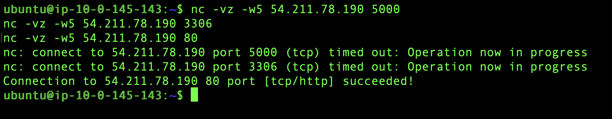 |
| Reboot test | 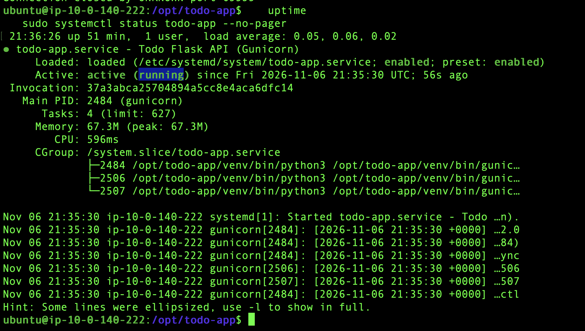 |
| HTTPS | 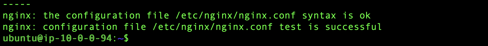 |

## Problems and fixes

See [PROBLEMS.md](PROBLEMS.md).
